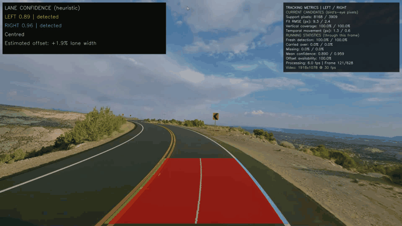
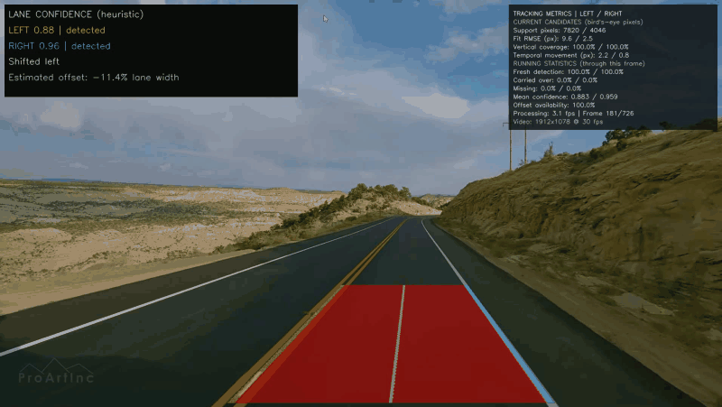
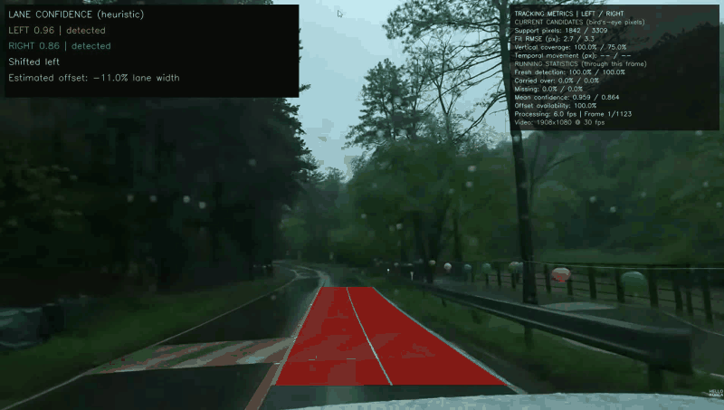

# Lane Keeping Assistance (LKA)

Classical computer vision for lane-boundary detection, tracking, and estimated vehicle position from driving videos.

## Overview

This project implements the perception part of Lane Keeping Assistance using Python, OpenCV, and NumPy. It processes recorded road footage frame by frame, finds the current lane boundaries, tracks them over time, and saves an annotated video with diagnostic measurements.

The method uses colour thresholds, perspective transformation, sliding windows, and polynomial fitting. No neural network or model training is used.

For each frame, the system provides:

- Separate left and right boundary curves and heuristic confidence scores.
- A red lane corridor and white lane-centre curve when both boundaries are available.
- An estimated offset as a percentage of lane width when detections support it.
- Explicit `detected`, `carried over`, or `missing` status for each boundary.
- Compact panels with current measurements and running statistics.

This is an offline video-analysis project. It does not control vehicle steering.

## Output demonstrations

### Daylight video 1: bends and shadows

The near-field overlay follows the yellow centre marking and white road edge as the road bends. This preview shows seconds 4–12 of the annotated output.

<p align="center">
  
</p>

[Full annotated video](outputs/l1_annotated.mp4) · [Input video](video_source/l1.mp4) · [Per-frame metrics](metrics/l1_frames.csv)

### Daylight video 2: hills and changing road direction

The same detector and tracker are used with a camera-specific road transformation. This preview shows seconds 6–14 of the annotated output.

<p align="center">
  
</p>

[Full annotated video](outputs/l2_annotated.mp4) · [Input video](video_source/l2.mp4) · [Per-frame metrics](metrics/l2_frames.csv)

### Rain test: partial detections and tracking failures

The wet forest road is substantially more difficult. Wipers, droplets, reflections, low contrast, and speed-hump markings interrupt or confuse lane evidence. This preview shows the first 10 seconds, including temporary carry-over and detection loss. Numeric offset is withheld when fresh detections are unavailable.

<p align="center">
  
</p>

[Full annotated test video](outputs/rain_dark_annotated.mp4) · [Rain input](test/rain_dark.mp4) · [Per-frame metrics](metrics/rain_dark_frames.csv) · [Failure review](outputs/rain_dark_review.jpg)

GIFs are short previews, resized to 800 pixels wide at 6 fps. Use the full videos for original resolution, 30 fps playback, and readable per-frame diagnostics. The results below cover complete clips, including failure frames.

## Project structure

```text
Lane-Keeping-Assistance/
├── codes/
│   ├── lka_pipeline.py          # Detection, tracking, offset, overlays and logging
│   ├── inspect_videos.py        # Daylight contact sheets and source metadata
│   ├── evaluate_outputs.py      # Daylight validation and evaluation report
│   ├── evaluate_clip.py         # Individual clip validation and failure review
│   └── test_pipeline.py         # Functional tests
├── configs/
│   ├── clips.json              # Daylight camera settings
│   └── rain_dark.json          # Rain camera settings
├── video_source/               # Two daylight source videos
├── test/                       # Rain source video
├── outputs/                    # Annotated videos, masks and review frames
├── metrics/                    # CSVs, JSON summaries and evaluation reports
├── docs/media/                 # Animated README previews
├── requirements.txt            # Core processing dependencies
├── .gitignore
└── README.md
```

Source videos, generated videos, previews, and measured results are intentionally included. Environments, caches, credentials, and machine-specific files are excluded by `.gitignore`.

## Installation

Python 3.10 was used for development. Run these commands from the repository root in Windows PowerShell:

```powershell
python -m venv .venv
.\.venv\Scripts\python.exe -m pip install -r requirements.txt
```

The core dependencies are OpenCV 4.10.0.84 and NumPy 1.26.4. Training data and pretrained models are not required.

## Usage

### Process both daylight videos

```powershell
.\.venv\Scripts\python.exe codes/inspect_videos.py
.\.venv\Scripts\python.exe codes/lka_pipeline.py
.\.venv\Scripts\python.exe codes/evaluate_outputs.py
```

`configs/clips.json` supplies the geometry for `video_source/l1.mp4` and `video_source/l2.mp4`.

### Process the rain test

```powershell
.\.venv\Scripts\python.exe codes/lka_pipeline.py --video test/rain_dark.mp4 --config configs/rain_dark.json
.\.venv\Scripts\python.exe codes/evaluate_clip.py --video test/rain_dark.mp4
```

The rain clip uses the same algorithm with a separate camera-specific road region. That setup means it is not a completely untouched benchmark.

### Process a short segment

```powershell
.\.venv\Scripts\python.exe codes/lka_pipeline.py --video video_source/l1.mp4 --start 4 --seconds 8
```

Each run replaces that clip's video and metrics. Evaluation scripts expect full-length outputs; a shortened run will fail their full-frame-count check. Annotated videos preserve the input resolution and frame rate and contain no audio.

### Run tests

```powershell
.\.venv\Scripts\python.exe -B codes/test_pipeline.py
```

Three tests cover temporary-loss handling and expiry, offset direction and suppression, and cumulative statistics including a valid zero offset.

## Pipeline overview

```text
Input frame
    -> Gaussian smoothing and HLS colour conversion
    -> White/yellow candidate masks using local brightness contrast
    -> Camera-specific bird's-eye transformation
    -> Histogram initialisation and sliding-window search
    -> Quadratic fitting with iterative outlier rejection
    -> Confidence, geometry and temporal checks
    -> Smoothed boundaries, lane centre and estimated offset
    -> Original-view overlay, annotated video and per-frame metrics
```

### 1. Candidate marking detection

`marking_mask()` searches for bright, low-saturation white paint and yellow paint in HLS colour space. Local contrast helps separate markings from nearby asphalt. White and yellow candidates are used on the left; the right boundary uses white candidates for the road convention in these clips.

### 2. Perspective transformation

Four normalised image points define the road transformation. The mask is mapped to a 640 × 480 bird's-eye image for fitting. This is an approximate road-plane transform, not physical camera calibration. The daylight region starts at 70% of image height; the rain region also excludes the hood.

### 3. Sliding windows and curve fitting

Bottom-half histograms initialise the searches. Twelve windows move upwards, following candidate pixels and previous curve predictions. A second-order curve, `x(t) = a*t² + b*t + c` with `t = y/480`, is fitted to each side. Three rounds of residual rejection reduce outlier influence.

### 4. Confidence and geometric validation

Confidence combines pixel support (30%), vertical coverage (35%), fit quality (20%), and temporal consistency (15%). Weak coverage, low confidence, or excessive movement reject a candidate. When two new boundaries exist, their width and width variation are also checked.

Confidence is a heuristic, not a calibrated probability. A convincing reflection can still produce an incorrect fit.

### 5. Temporal tracking

Accepted curves are smoothed using 30% of the new curve and 70% of the previous curve. A recent curve may be reused for approximately 0.35 seconds during a loss. Reused curves are dashed and labelled `carried over`, with decaying confidence. Longer losses become `missing`.

### 6. Lane centre and estimated offset

Both boundaries are evaluated at the same cross-section in the bird's-eye view:

```text
lane centre = (left boundary + right boundary) / 2
offset (%) = 100 * (vehicle reference - lane centre) / lane width
```

Positive means right of lane centre; negative means left. The vehicle reference assumes a centred, forward-facing camera (`vehicle_reference_x = 0.5`). It has not been physically measured. Offset is an estimated percentage of lane width, not metres.

Numeric offset requires two fresh detections with sufficient confidence. Carried or missing boundaries suppress it. The centred and near-boundary labels use illustrative 8% and 35% thresholds; these are not validated safety margins.

## Output overlays and metrics

| Display | Meaning |
| --- | --- |
| Yellow boundary | Left lane boundary |
| Cyan boundary | Right lane boundary |
| Red shading | Corridor between the available boundaries |
| White centre curve | Midpoint of the boundary curves |
| Dashed boundary | Temporarily carried-over fit |
| Top-left panel | Current confidence, status, position and estimated offset |
| Top-right panel | Candidate measurements, cumulative rates and processing information |

The top-right panel includes support pixels, fit RMSE, vertical coverage, movement, fresh/carry/missing rates, mean confidence, offset availability, processing FPS, and frame progress. Pixel units refer to the bird's-eye image. `--` indicates an unavailable measurement. Candidate diagnostics may describe rejected candidates; the status panel identifies whether a boundary was accepted.

Each `metrics/<clip>_frames.csv` records frame/time identifiers, offset and position, running processing FPS, and separate left/right status, confidence, support, RMSE, coverage, and movement. Summary JSON files aggregate results. Validation JSON files record saved-video consistency checks.

## Results

These statistics cover the complete supplied videos:

| Clip | Duration | Frames | Fresh left | Fresh right | Offset available |
| --- | ---: | ---: | ---: | ---: | ---: |
| Daylight 1 (`l1`) | 20.93 s | 628 | 100.0% | 100.0% | 100.0% |
| Daylight 2 (`l2`) | 24.20 s | 726 | 100.0% | 100.0% | 100.0% |
| Rain test (`rain_dark`) | 37.43 s | 1,123 | 40.1% | 13.8% | 11.2% |

| Clip | Mean confidence L / R | Carried over L / R | Missing L / R |
| --- | ---: | ---: | ---: |
| Daylight 1 | 0.889 / 0.959 | 0.0% / 0.0% | 0.0% / 0.0% |
| Daylight 2 | 0.884 / 0.959 | 0.0% / 0.0% | 0.0% / 0.0% |
| Rain test | 0.396 / 0.152 | 9.0% / 9.9% | 50.9% / 76.3% |

**Detection availability is not accuracy.** A fresh detection means the algorithm accepted a candidate, not that it matched a labelled true boundary. Mean confidence includes detection losses. No ground-truth annotations were supplied, so precision, recall, F1, IoU, and true boundary-position error have not been measured.

All 2,477 saved frames passed frame-count, resolution, and frame-rate checks. These verify output consistency rather than perception accuracy. Processing is offline; throughput depends on the machine and workload and is distinct from the 30 fps playback rate.

[Daylight evaluation](metrics/EVALUATION.md) · [Rain evaluation](metrics/rain_dark_EVALUATION.md) · [Daylight validation](metrics/validation.json) · [Rain validation](metrics/rain_dark_validation.json)

## Failure modes and limitations

- **Rain and reflections:** paint becomes hard to distinguish from wet-road glare. The right boundary is missing in 76.3% of rain frames.
- **Wipers and droplets:** markings can be occluded or distorted, causing carry-over and eventual loss.
- **Speed humps and road text:** transverse or bright markings can be mistaken for boundary evidence.
- **Fixed geometry:** hills, sharp curves, camera motion, merges and changing lane width can violate the configured road-plane assumptions.
- **Temporal lag:** smoothing reduces shaking but can respond slowly to rapid changes.
- **Unmeasured vehicle reference:** offset depends on assumed camera alignment and is not a calibrated physical distance.
- **Limited evaluation:** two daylight scenes and one rain scene do not establish general robustness. Camera, road and lighting differences prevent isolating rain as the sole cause of performance differences. Night, snow and dense traffic have not been evaluated here.

## Future improvements

1. Label working and failure frames to measure boundary error and false detections.
2. Use illumination-adaptive thresholds and stronger rejection of reflections and transverse markings.
3. Calibrate camera geometry and independently measure the vehicle reference.
4. Improve recovery through occlusion and sharper curves.
5. Evaluate independent footage and profile the pipeline before making real-time claims.

## Technical stack

- Python 3.10 (development environment)
- OpenCV 4.10.0.84
- NumPy 1.26.4
